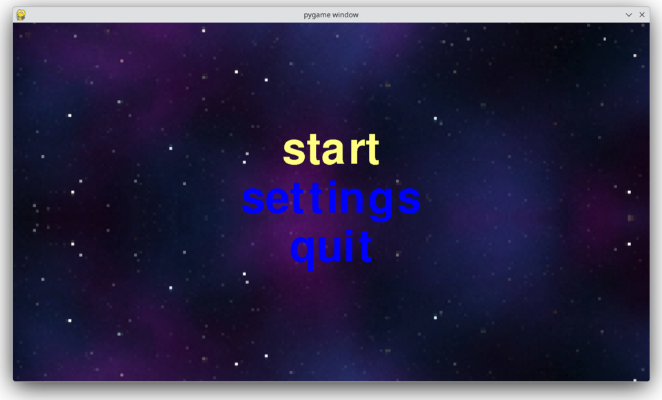
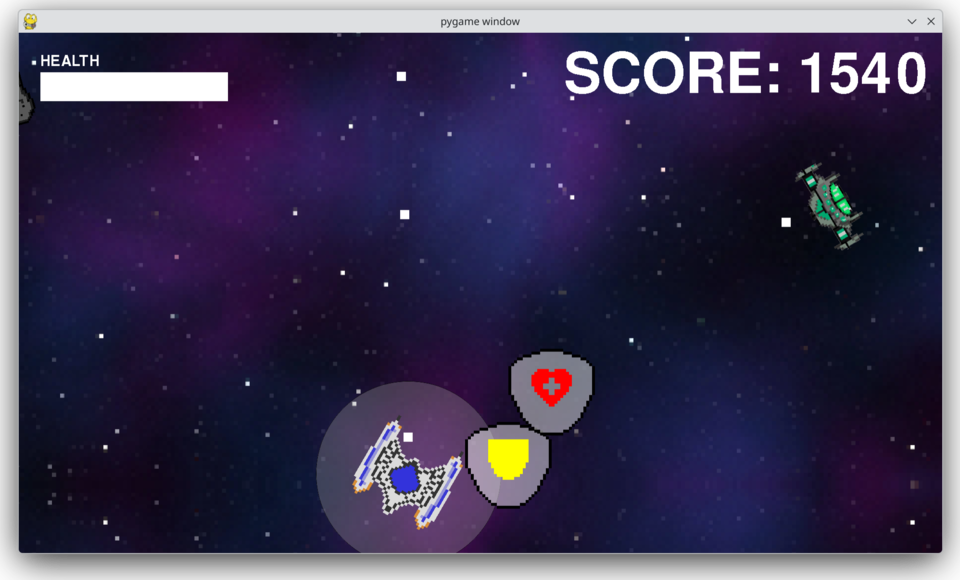
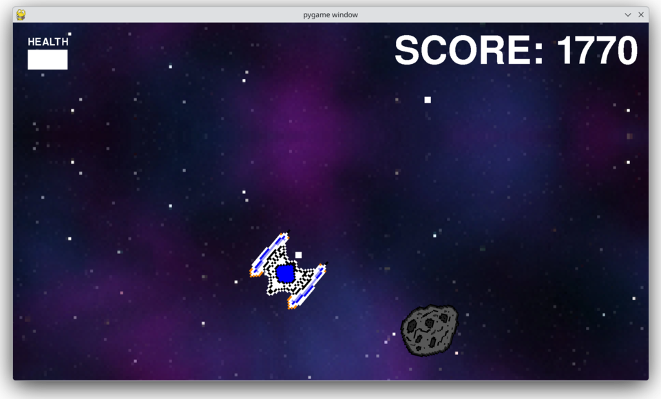
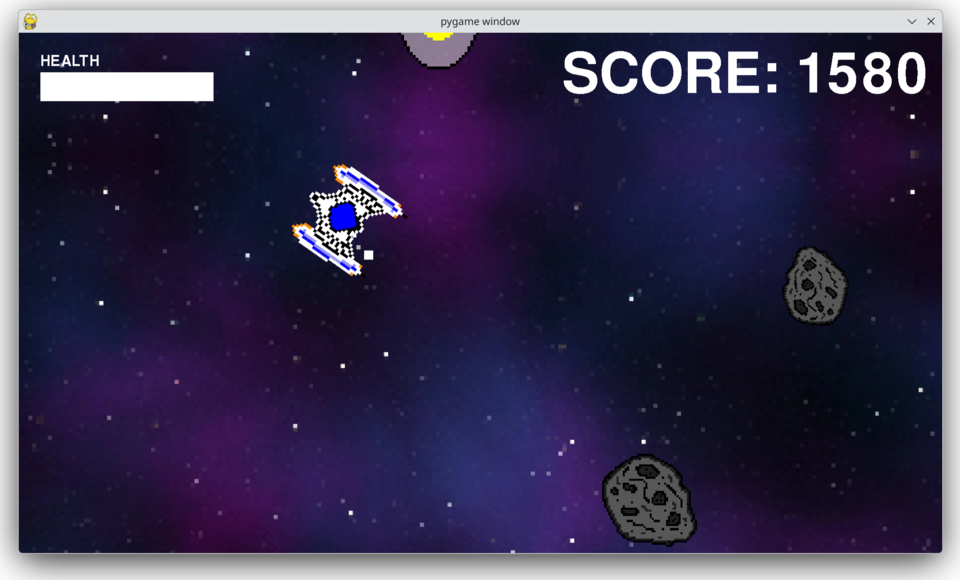
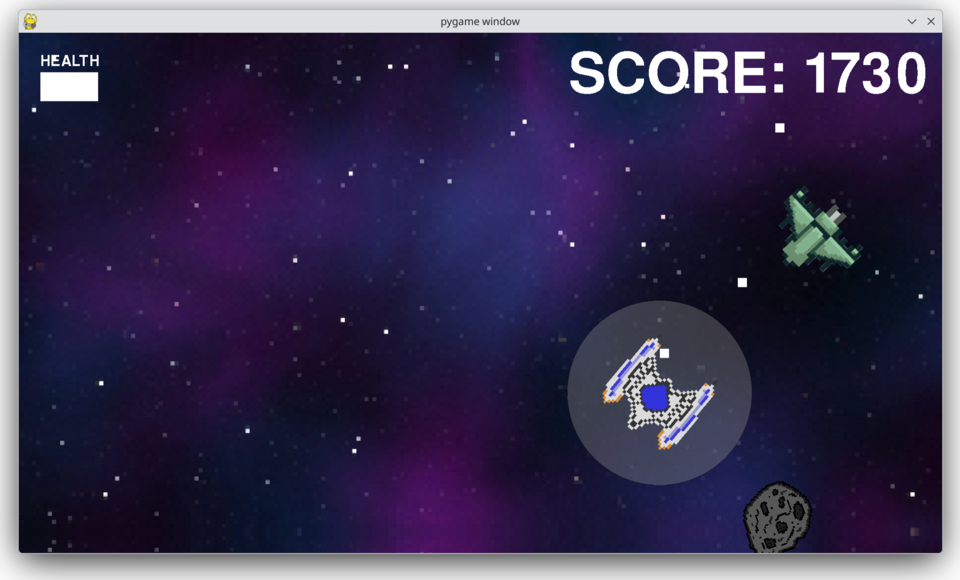
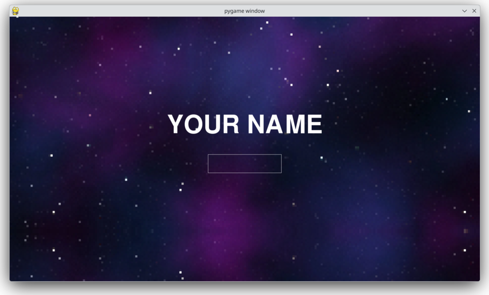

# Space Game

Ein einfaches 2D-Weltraumspiel mit Powerups und Highscore-Liste, entwickelt mit [pygame-ce](https://pyga.me).





## Installation

Unterstützt Systeme mit `apt` (Debian, Ubuntu, Mint …) und `pacman` (Arch, Manjaro, CachyOS …).

```bash
git clone https://github.com/bawsuser/space_game.git
cd space_game/
bash setup.sh
source ~/.bashrc
```

`setup.sh` erkennt den Paketmanager, installiert fehlendes Python (inkl. venv und pip) und ruft dann `install.sh` auf. Das legt ein virtuelles Environment (`.venv`) an, installiert `pygame-ce` und richtet den Alias `spacegame` in `~/.bashrc` ein. Beide Skripte können beliebig oft ausgeführt werden.

## Starten

```bash
spacegame                # von überall, nach der Installation
# oder direkt im Projektordner:
.venv/bin/python main.py
```

Immer `main.py` starten, nicht `game_loop.py` (wegen des zirkulären Imports).

## Steuerung

| Taste        | Aktion                    |
|--------------|---------------------------|
| `W` `A` `S` `D` | Schiff bewegen         |
| `←` `→`      | Schiff drehen             |
| `Leertaste`  | Schießen                  |
| `ESC`        | Pause-Menü                |
| `W` / `S` + `Enter` | Menü bedienen      |



## Powerups

| Item | Wirkung |
|------|---------|
| Health | +10 Leben |
| Shield | Schutzschild für 10 Sekunden |
| Speed | doppelte Feuerrate |
| Shockwave | Druckwelle, die Asteroiden und gegnerische Schüsse zerstört |
| 4-Way-Shoot | Schüsse in vier Richtungen |





## Highscore

Nach dem Game-Over trägst du deinen Namen ein, die Ergebnisse landen in einer lokalen SQLite-Datenbank (`scores.db`).



## Einstellungen

Im Startmenü unter `settings` lassen sich Fullscreen und Auflösung (720p bis 4K) einstellen. Beim ersten Start wird die Monitorauflösung automatisch erkannt. Fullscreen gilt sofort, eine neue Auflösung nach dem nächsten Start.
